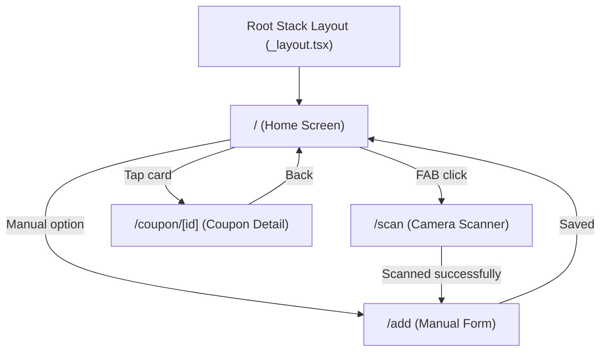
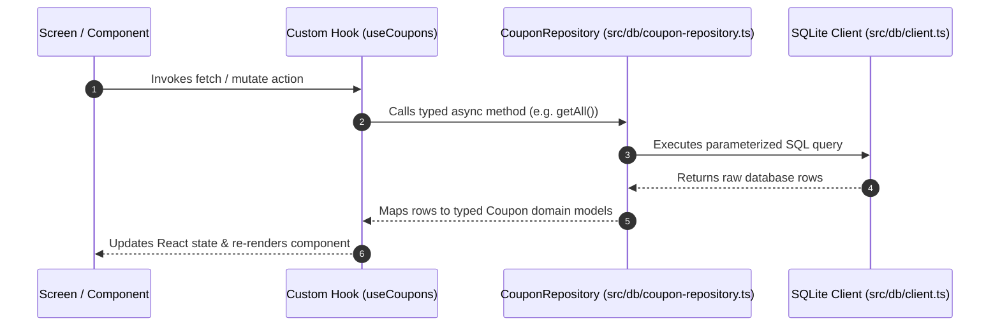

# Cashout — System Architecture Documentation

## Overview
Cashout is an Android mobile application built with **React Native** and **Expo SDK 57**. It serves as a digital wallet for bottle deposit coupons, allowing users to scan, store, view, and redeem physical coupon barcodes.

### Core Tech Stack
- **Framework:** React Native / Expo SDK 57 (Android target)
- **Routing & Navigation:** Expo Router (file-based routing)
- **UI Library:** React Native Paper (Material Design 3)
- **Local Persistence:** `expo-sqlite` (SQLite database with Repository pattern)
- **Path Aliasing:** `@/*` mapped to `./src/*`

---

## Project Structure

The project follows standard Expo file-based conventions, isolating routing declarations inside `src/app/` while keeping screen implementations, reusable components, database access, hooks, and utilities cleanly decoupled.

```
cashout/
├── assets/                        # Static assets (icons, splash, fonts)
├── docs/                          # Project documentation (spec-driven)
├── scripts/                       # Build and utility scripts
├── src/
│   ├── app/                       # Expo Router routes ONLY
│   │   ├── _layout.tsx            # Root layout (PaperProvider, theme)
│   │   ├── index.tsx              # Home — coupon list
│   │   ├── scan.tsx               # Barcode scanner
│   │   ├── add.tsx                # Manual coupon entry form
│   │   └── coupon/
│   │       └── [id].tsx           # Coupon detail + full-screen barcode
│   ├── components/                # Reusable UI components
│   │   ├── coupon-card.tsx        # Coupon list item
│   │   ├── barcode-display.tsx    # Renders barcode from value+format
│   │   └── empty-state.tsx        # Empty list placeholder
│   ├── screens/                   # Screen bodies rendered by route files
│   │   ├── home/
│   │   │   └── index.tsx
│   │   ├── scan/
│   │   │   └── index.tsx
│   │   └── coupon-detail/
│   │       └── index.tsx
│   ├── db/                        # Database layer
│   │   ├── schema.ts              # Table definitions, migrations
│   │   ├── client.ts              # SQLite client singleton
│   │   └── coupon-repository.ts   # CRUD operations for coupons
│   ├── hooks/                     # Custom React hooks
│   │   ├── use-coupons.ts         # Coupon list data hook
│   │   └── use-coupon.ts          # Single coupon data hook
│   ├── utils/                     # Pure utility functions + tests
│   │   ├── barcode.ts             # Barcode validation, formatting
│   │   └── date.ts                # Date formatting, expiry checks
│   ├── constants.ts               # App-wide constants
│   └── theme.ts                   # React Native Paper theme config
├── app.json                       # Expo config
├── package.json
└── tsconfig.json
```

### Directory Responsibilities

| Directory | Purpose | Key Rules |
| :--- | :--- | :--- |
| `src/app/` | Expo Router route definitions | Thin wrappers only. Must delegate UI to `src/screens/`. |
| `src/screens/` | Full-page screen components | Contains screen-specific layout, state orchestration, and sub-components. |
| `src/components/` | Reusable UI components | Modular components (cards, barcode renderers, empty states). |
| `src/db/` | Data persistence & SQLite | Schema definitions, database connection singleton, repository implementation. |
| `src/hooks/` | Custom React hooks | Encapsulates async data fetching, DB interactions, and screen state logic. |
| `src/utils/` | Utility functions | Pure, side-effect-free helper modules accompanied by unit tests (`*.test.ts`). |

---

## Navigation Architecture

Navigation is managed by **Expo Router** using file-based routing. The root structure is powered by a Native Stack navigator defined in `src/app/_layout.tsx`.

### Route Mapping

| Route Path | File Location | Screen Component | Parameters | Description |
| :--- | :--- | :--- | :--- | :--- |
| `/` | `src/app/index.tsx` | `HomeScreen` | None | Main dashboard displaying active and redeemed coupon list. |
| `/scan` | `src/app/scan.tsx` | `ScanScreen` | None | Camera-based barcode scanner for auto-detecting coupon details. |
| `/add` | `src/app/add.tsx` | `AddCouponScreen` | `barcodeValue?` | Manual entry form for creating/editing coupons. |
| `/coupon/[id]` | `src/app/coupon/[id].tsx` | `CouponDetailScreen` | `id` (string/UUID) | Detailed coupon view featuring full-screen display of the generated barcode. |

### Deep Linking
- **Scheme:** `cashout://` (configured in `app.json`)
- **Example Deep Links:**
  - `cashout://` -> Opens Home screen
  - `cashout://scan` -> Opens Barcode Scanner screen
  - `cashout://coupon/123e4567-e89b-12d3-a456-426614174000` -> Opens detail view for specified coupon UUID

### Navigation Flow Diagram



---

## Data Layer Architecture

Local persistence relies on `expo-sqlite` structured around the **Repository Pattern**. Direct SQLite queries within React UI components are strictly forbidden.

### Architecture Components

1. **SQLite Client Singleton (`src/db/client.ts`)**:
   - Manages single connection instance to the local SQLite database.
   - Handles thread safety and async initialization.
2. **Schema & Migrations (`src/db/schema.ts`)**:
   - Contains DDL statements for `coupons` table.
   - Version-stamped migration runner checking `PRAGMA user_version` during app startup.
3. **Repository (`src/db/coupon-repository.ts`)**:
   - Exposes strongly-typed async CRUD functions:
     - `getAll(): Promise<Coupon[]>`
     - `getById(id: string): Promise<Coupon | null>`
     - `insert(coupon: CreateCouponDto): Promise<Coupon>`
     - `update(id: string, update: UpdateCouponDto): Promise<Coupon>`
     - `delete(id: string): Promise<void>`
4. **Data Hooks (`src/hooks/use-coupons.ts`, `src/hooks/use-coupon.ts`)**:
   - Expose reactively managed data state and mutation triggers to screens.

### Data Flow Diagram



### Future PostgreSQL / Cloud Sync Compatibility
- Primary keys are generated as **UUID v4** strings on the client.
- All timestamps are stored as **ISO 8601 UTC strings** (`YYYY-MM-DDTHH:mm:ss.sssZ`).
- Table columns and types mirror relational structures compatible with PostgreSQL / Supabase migration (see [`DATA_MODEL.md`](file:///c:/Users/konra/Repozytoria/cashout/docs/DATA_MODEL.md)).

---

## UI Architecture

The UI is built on **React Native Paper** (Material Design 3 framework).

### Configuration & Theme

- **Root Provider:** `PaperProvider` wraps the application inside `src/app/_layout.tsx`.
- **Dynamic Theming:** Configured in `src/theme.ts`. Automatically responds to system color schemes (light and dark mode) via React Native's `useColorScheme`.

```typescript
// Example theme integration flow
import { MD3LightTheme, MD3DarkTheme, PaperProvider } from 'react-native-paper';
import { useColorScheme } from 'react-native';
import { AppTheme } from '@/theme';

export default function RootLayout() {
  const colorScheme = useColorScheme();
  const theme = colorScheme === 'dark' ? AppTheme.dark : AppTheme.light;

  return (
    <PaperProvider theme={theme}>
      <Stack />
    </PaperProvider>
  );
}
```

### Component Guidelines
- **Custom UI Components:** Reside in `src/components/`. Built by composition using React Native Paper primitives (`Card`, `Text`, `Button`, `Surface`, `FAB`).
- **Styling:** Colocated inside component files using `StyleSheet.create()`. Hardcoded color literals are prohibited; design tokens from React Native Paper `useTheme()` must be utilized.

---

## Key Conventions

### 1. File & Directory Naming
- Use **kebab-case** for all file names and directories (e.g., `coupon-card.tsx`, `use-coupons.ts`, `coupon-repository.ts`).

### 2. Export Standard
- Use **one named export per file** for components, hooks, and utilities (e.g., `export const CouponCard = ...`).
- Route files in `src/app/` use `export default` as required by Expo Router conventions.

### 3. Separation of Concerns (Thin Routes)
- Route files inside `src/app/` are strict entry points. They render top-level container screens from `src/screens/` and do not contain complex inline UI logic.

### 4. Unit Testing Standard
- Test files are colocated next to their target source files using the `*.test.ts` or `*.test.tsx` naming convention (e.g., `src/utils/barcode.ts` -> `src/utils/barcode.test.ts`).

### 5. Data Standards
- **Dates:** Stored and passed strictly as ISO 8601 UTC strings (`YYYY-MM-DDTHH:mm:ss.sssZ`).
- **Primary Keys:** UUID v4 string generation for all persistent entities to ensure offline-first safety and seamless cloud sync.
